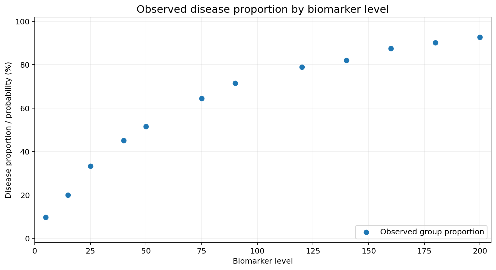
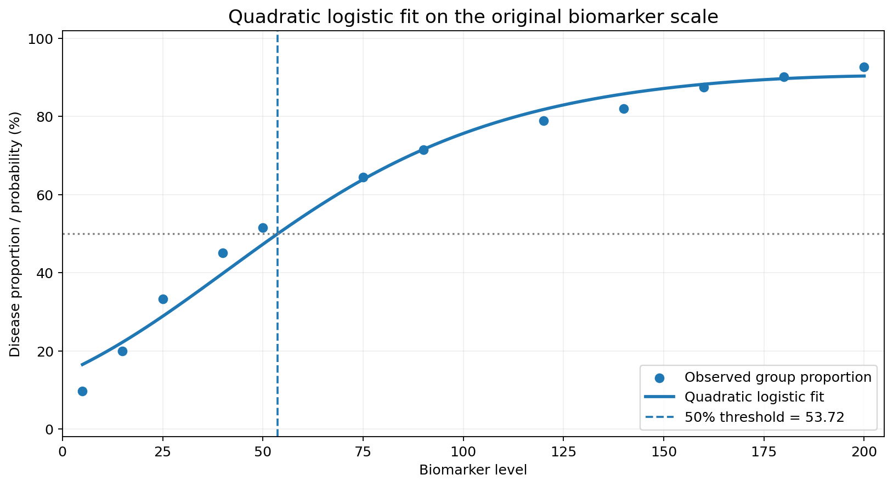
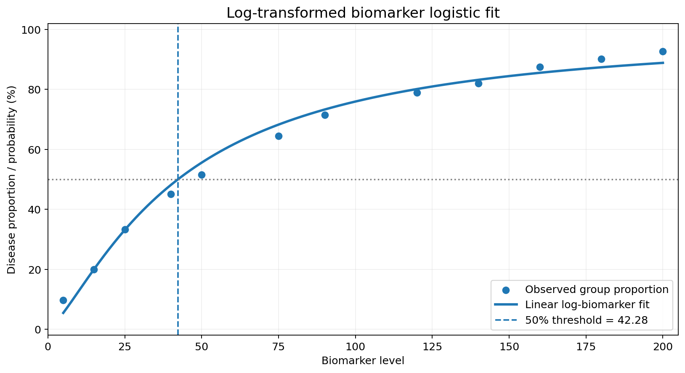
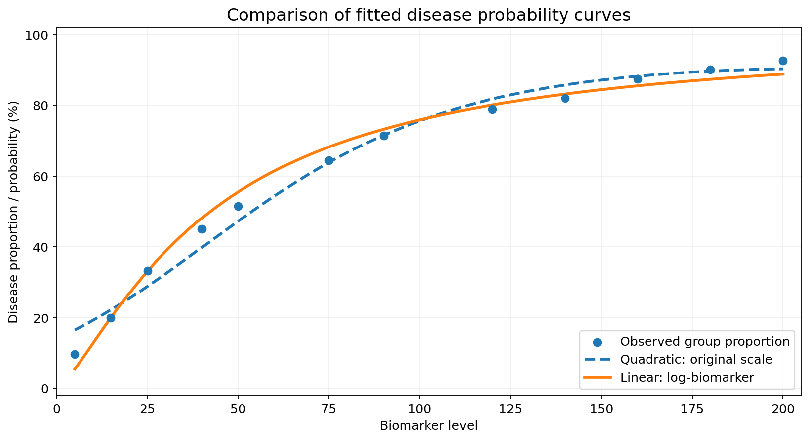
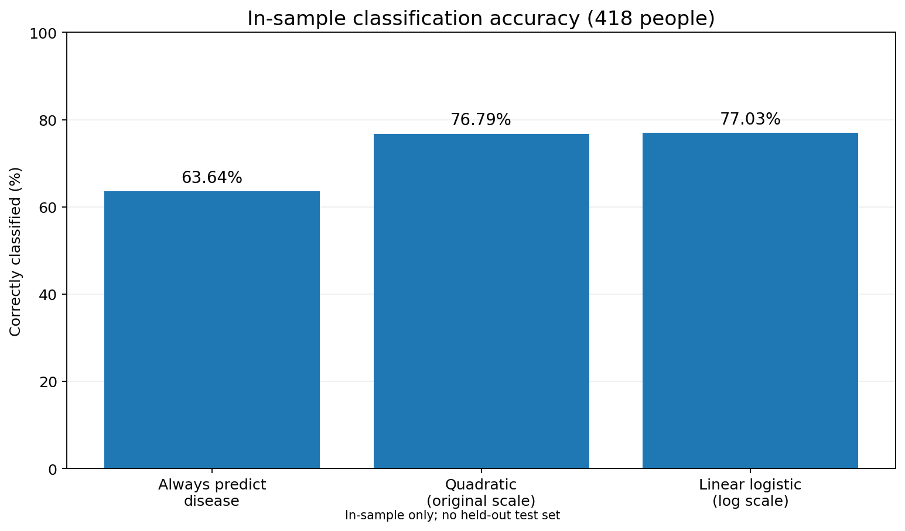

# Biomarker-Based Disease Classification with Logistic Regression in R

**R | Generalised Linear Models | Grouped Binomial Regression | Likelihood-Ratio Tests | Classification**

A statistical modelling portfolio reconstructed from a completed **MATH3091 undergraduate coursework analysis at the University of Southampton**. The study uses grouped disease counts to investigate whether a biomarker is associated with the probability of disease, compare polynomial logistic regression specifications, and estimate an illustrative classification threshold.

> **Source/provenance:** Model formulas, key numerical results, and much of the original analysis logic come from the student's submitted coursework report. The separate original R Markdown file was a mostly unfilled template. The modular R scripts here were **reconstructed and reorganised later**, not recovered as the exact original submitted `.R` files.

## Research questions

1. How does the observed proportion of people with disease vary with biomarker level?
2. Does adding polynomial terms improve a grouped-binomial logistic regression fit?
3. Can a log transformation provide a simpler and interpretable model?
4. What is the biomarker level corresponding to a fitted disease probability of 50%, and what is the **in-sample** classification accuracy?

## Data overview

The university-supplied file `immune.csv` comprises **12 grouped biomarker levels**, with **418 individuals** represented through counts of people with (`disease`) and without (`nodisease`) the outcome. The records are aggregated counts, **not** 418 individual rows. The original file is **not redistributed** here because redistribution rights have not been verified. See [data availability](data/README.md).

## Statistical methods

The grouped-binomial logistic regression model is

```math
\log\left(\frac{p(x)}{1-p(x)}\right) = \beta_0 + \sum_{j=1}^{k} \beta_j x^j
```

Log-transformed specifications replace `x` with `log(x)`. Models with polynomial degrees **1–5** were compared using **sequential likelihood-ratio tests (LRT)**, following the original report's 5% decision rule.

## Key results

| Comparison / metric | Coursework result |
| --- | ---: |
| Original-scale linear vs quadratic, LR test | **p ≈ 0.0225** |
| Original-scale quadratic vs cubic, LR test | **p ≈ 0.1231** |
| Log-scale linear vs quadratic, LR test | **p ≈ 0.1434** |
| Selected original-scale model | Quadratic logistic regression |
| Selected parsimonious log-scale model | Linear in `log(biomarker)` |
| Selected log-model threshold where `p = 0.5` | **42.28** |
| Log-model **in-sample** accuracy | **322/418 = 77.03%** |
| Original-scale quadratic **in-sample** accuracy | **321/418 = 76.79%** |
| Majority-class baseline **in-sample** accuracy | **266/418 = 63.64%** |

For the preferred parsimonious log-biomarker model, the report estimated:

```math
\log\left(\frac{p(x)}{1-p(x)}\right) \approx -5.00554 + 1.33683\log(x)
```

The 50% probability threshold is `exp(5.00554 / 1.33683) ≈ 42.28`. The classification rates are **training-sample descriptions**, not independent predictive performance estimates. The log-quadratic model has a very slightly lower AIC than the log-linear model; the selection above is based on the sequential 5% LRT and parsimony, **not** on minimising AIC. See [methodological notes](docs/methodological_notes.md).

## Visualisations

The preview charts below were independently reconstructed from the grouped counts during portfolio preparation (using Python/Matplotlib). The included **R scripts reproduce the corresponding statistical graphics locally** when the user supplies an authorised copy of the data.

### Observed disease proportions



The grouped proportions rise with biomarker level; the relationship is not adequately summarised by a simple untransformed linear probability trend.

### Quadratic logistic fit on the original scale



Adding the quadratic term significantly improves fit over the original-scale linear logistic model, according to the sequential LRT (p ≈ 0.0225). Its in-range 50% threshold is approximately **53.72**.

### Selected linear log-biomarker model



A linear term in the **logarithm** of biomarker level yields a simpler selected model and an estimated 50% cutoff around **42.28**.

### Comparing fitted probability curves



Both models capture the broad increasing relationship. Differences between these fitted curves do not constitute independent evidence of predictive superiority.

### In-sample classification comparison



The log-biomarker rule correctly classifies **322 of 418** individuals in the available grouped data, versus **266 of 418** for always predicting disease. This analysis does **not** use a held-out test set.

## Repository structure

```text
.
├── R/
│   ├── helpers.R                  # data validation, GLM, LRT and accuracy helpers
│   ├── 01_explore_data.R          # descriptive grouped analysis
│   ├── 02_polynomial_logistic.R   # polynomial models, tests and fitted chart
│   ├── 03_log_biomarker_model.R   # log-transformed models and classification
│   └── run_all.R                  # executes the three analysis scripts
├── data/                          # data instructions; original CSV excluded
├── figures/                       # five selected preview graphics
├── results/                       # R-generated CSVs remain local
├── tests/basic_checks.R           # formula and dataset consistency checks
├── docs/methodological_notes.md   # methodological and provenance caveats
├── .gitignore
└── README.md
```

## How to run in RStudio

Install **R / RStudio**. The scripts use **base R only**, with no extra CRAN packages required. Set the R working directory to the project root, and add your authorised copy of `immune.csv` as `data/immune.csv` (see [instructions](data/README.md)). Then run:

```r
setwd("D:/Biomarker-Logistic-Regression-GitHub-Ready") # change to your folder
source("tests/basic_checks.R")
source("R/run_all.R")
```

The scripts create local `.csv` tables in `results/` and `.png` plots in `figures/`. The source dataset and generated CSV results are ignored by Git, while the selected PNG previews are part of the portfolio.

You can run `source("tests/basic_checks.R")` **without the CSV** for independent formula checks; full analysis requires the local dataset.

## Reproducibility and limitations

- Model results were independently compared with the original submitted coursework using Python `statsmodels` and matched to displayed precision. The reconstructed R scripts were also executed successfully in RStudio, including the complete `R/run_all.R` workflow, and key outputs matched the original submitted results.
- Because the source data are grouped, the reported classification accuracies are **in-sample only**, and no held-out or prospective clinical validation was performed.
- The results show statistical association, not causation. **This project is educational and is not a validated medical diagnostic tool.**
- The original coursework question paper, identifiable student report, and CSV are not included in this public-ready archive. Obtain permission before redistributing source data.
